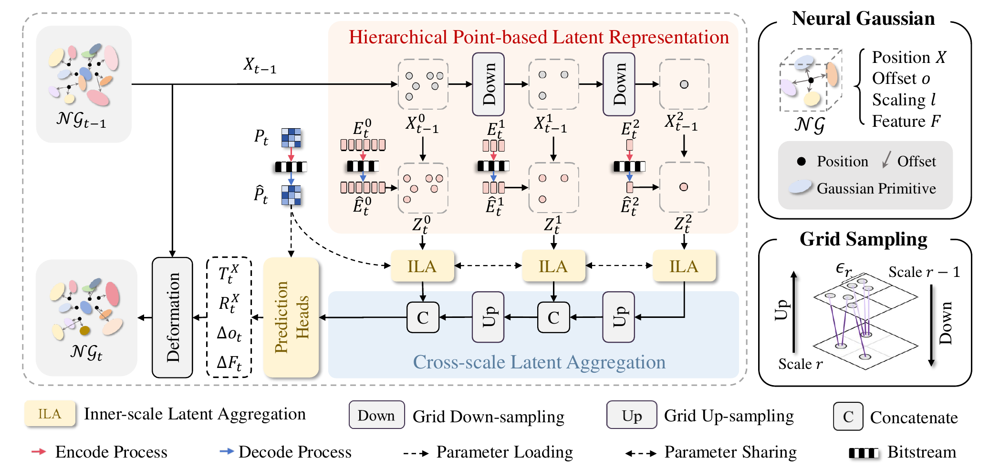

<h1 align="center">HPC: Hierarchical Point-based Latent Representation for Streaming Dynamic Gaussian Splatting Compression</h1>

<p align="center">
  Yangzhi Ma · Bojun Liu · Wenting Liao · Dong Liu · Zhu Li · Li Li
</p>

<h3 align="center">IEEE TCSVT 2026</h3>

<h4 align="center"><a href="https://ieeexplore.ieee.org/abstract/document/11789675">Paper</a></h4>

<p align="center">
  
</p>

HPC compresses dynamic Gaussian Splatting sequences using hierarchical point latents and temporally predicted network parameters. This repository provides training, entropy coding, standalone sequence decoding, and rendering.

## Overview

HPC represents frame-to-frame changes with a compact hierarchy of point latents. Inter-layer aggregation (ILA) combines information across scales, and lightweight networks map the aggregated features to Gaussian updates. Temporal prediction reduces the cost of transmitting network parameters between refresh frames.

- **Hierarchical latents:** multi-scale point features with inter-layer aggregation.
- **Temporal parameter prediction:** parameter residuals relative to decoded networks.
- **Entropy coding:** factorized coding for latents and tensor-wise Gaussian coding for quantized network parameters.

## Installation

The reference environment uses **Python 3.8**, **PyTorch 1.12.1**, and **CUDA 11.6** on Linux.

Run all commands below from the project root.

### Prepare the extensions

```bash
unzip submodules/diff-gaussian-rasterization.zip -d submodules
unzip submodules/gridencoder.zip -d submodules
unzip submodules/simple-knn.zip -d submodules
```

### Set up the environment

```bash
conda env create -f environment.yml
conda activate hpc

python -m pip install torch-scatter==2.1.0 -f https://data.pyg.org/whl/torch-1.12.0+cu116.html
python -m pip install 'git+https://github.com/facebookresearch/pytorch3d.git@v0.7.3'

python -m pip install --no-build-isolation ./submodules/diff-gaussian-rasterization
python -m pip install --no-build-isolation ./submodules/gridencoder
python -m pip install --no-build-isolation ./submodules/simple-knn
```

The CUDA extensions are compiled during installation. LPIPS evaluation downloads pretrained weights on first use if they are not already cached.

## Datasets

Configurations are provided for **[MeetRoom](https://github.com/AlgoHunt/StreamRF)** and **[N3DV](https://github.com/facebookresearch/Neural_3D_Video)**:

| Dataset | Scene names | Original image resolution (W × H) | Example frame range |
| --- | --- | --- | --- |
| MeetRoom | `discussion`, `trimming`, `vrheadset` | 1280 × 720 | 0–299 |
| N3DV | `coffee_martini`, `cook_spinach`, `cut_roasted_beef`, `flame_salmon_1`, `flame_steak`, `sear_steak` | 2704 × 2028 | 0–299 |

Each scene has a configuration at `configs/<dataset>/<scene>/<scene>.json`. Prepare undistorted multi-view images and COLMAP camera data for each frame:

```text
data/
├── MeetRoom/
│   └── trimming/
│       ├── frame000000/
│       │   ├── images/
│       │   └── sparse/0/
│       ├── frame000001/
│       │   ├── images/
│       │   └── sparse/0/
│       └── ...
└── N3DV/
    └── coffee_martini/
        ├── frame000000/
        │   ├── images_2/
        │   └── sparse/0/
        └── ...
```

The `sparse/0/` directory contains COLMAP intrinsics, extrinsics, and point-cloud files. Frame 0 supplies the point cloud used to initialize the Gaussian scene. Keep camera names consistent across time and preserve each configuration's image resolution and train/test split.

## Training

Training processes frames sequentially. Frame 0 initializes the Gaussian scene; subsequent frames optimize the hierarchical latents and update networks. The commands below also run entropy encoding, decoding, and reconstruction evaluation automatically.

### MeetRoom

```bash
CUDA_VISIBLE_DEVICES=0 python train_videos.py \
  --config_path configs/MeetRoom/trimming/trimming.json \
  --data-root data/MeetRoom \
  --output-root outputs --experiment hpc \
  --I_lmbda 0.004 --P_lmbda 0.5 \
  --nn_bitdepth 8 --gop-size 5 \
  --frame-start 0 --frame-end 299 --seed 0
```

### N3DV

```bash
CUDA_VISIBLE_DEVICES=0 python train_videos.py \
  --config_path configs/N3DV/coffee_martini/coffee_martini.json \
  --data-root data/N3DV \
  --output-root outputs --experiment hpc \
  --I_lmbda 0.004 --P_lmbda 0.5 \
  --nn_bitdepth 8 --gop-size 5 \
  --frame-start 0 --frame-end 299 --seed 0
```

Change the scene configuration to train another sequence. Frame endpoints are inclusive, and `--data-root` is the directory containing the scene folders. When starting from a frame greater than 0, the preceding frame's saved model must already exist in the same output sequence.

### Rate–distortion settings

Keep `--I_lmbda 0.004` and choose one of the following dynamic rate factors. The dynamic rate-loss coefficient is `I_lmbda × P_lmbda`.

| `--P_lmbda` | Dynamic rate-loss coefficient |
| --- | --- |
| 0.5 | 0.002 |
| 4.0 | 0.016 |
| 8.0 | 0.032 |
| 12.0 | 0.048 |

`0.5` is the highest-rate setting. The default representation uses **3 scales**, **16 channels per scale**, an inter-scale point ratio of **0.2**, and **kNN K=4**. Initial-frame and dynamic optimization use 15,000 and 500 iterations, respectively.

With GOP5, network refreshes occur at frame 1 and then at frame indices divisible by 5. A network refresh resets network prediction, not the entire Gaussian scene.

## Evaluation

For the Trimming example above:

- **PSNR / SSIM / LPIPS:** `outputs/hpc/trimming/0.004_0.5/frames_results.json`
- **Per-frame metrics:** `outputs/hpc/trimming/0.004_0.5/frameXXXXXX/results.json`
- **Coding logs:** `outputs/hpc/trimming/0.004_0.5/frameXXXXXX/outputs.log`
- **Per-frame storage in bytes (after packing):** `streams/trimming/rate_report.csv`

## Encoding and Decoding

### Collect the encoded sequence

Training already creates the encoded frame files. Collect them into a standalone sequence directory:

```bash
python hpc_codec.py pack \
  --source outputs/hpc/trimming/0.004_0.5 \
  --output streams/trimming --end 299
```

`--end` is inclusive. If save iterations differ from the defaults, supply `--initial-iteration` and `--iteration` when collecting the files.

### Decode independently

```bash
CUDA_VISIBLE_DEVICES=0 python hpc_codec.py decode \
  --input streams/trimming --output decoded/trimming
```

The decoder uses only the collected stream and previously decoded frames. It does not need the original training checkpoints, dataset, or GT images. Each decoded frame contains `point_cloud.ply` and `networks.pt`.

### Render the decoded frames

```bash
CUDA_VISIBLE_DEVICES=0 python render_decoded.py \
  --stream streams/trimming \
  --decoded decoded/trimming \
  --cameras outputs/hpc/trimming/0.004_0.5/frame000000/cameras.json \
  --camera-id 0 --output renders/trimming
```

Camera parameters are a separate rendering input, not a decoding dependency. Use the generated `cameras.json` or a compatible camera list containing `id`, `width`, `height`, `fx`, `fy`, `position`, and `rotation`. Omit `--camera-id` to render all supplied cameras. For another render resolution, scale the image dimensions and focal lengths consistently.

### Optional: offline entropy re-encoding

Re-encode retained quantized symbols without optimization:

```bash
CUDA_VISIBLE_DEVICES=0 python hpc_codec.py encode \
  --source streams/trimming --output streams/trimming_reencoded --end 299
```

This preserves the original quantization ranges. It does not train a model or convert an arbitrary floating-point checkpoint into a stream.

## Citation

If you find this work useful for your research, please consider citing us:

```bibtex
@ARTICLE{11789675,
  author={Ma, Yangzhi and Liu, Bojun and Liao, Wenting and Liu, Dong and Li, Zhu and Li, Li},
  journal={IEEE Transactions on Circuits and Systems for Video Technology},
  title={HPC: Hierarchical Point-based Latent Representation for Streaming Dynamic Gaussian Splatting Compression},
  year={2026},
  volume={},
  number={},
  pages={1-1},
  keywords={Modeling;Optimization;Videos;High performance computing;Rate-distortion;Neural networks;Quantization (signal);Conferences;Streams;Bit rate;Dynamic Gaussian Splatting Compression;Free-viewpoint Video;Latent Representation},
  doi={10.1109/TCSVT.2026.3752482}}
```

## Acknowledgements

This work builds upon [3DGS](https://github.com/graphdeco-inria/gaussian-splatting), [Scaffold-GS](https://github.com/city-super/Scaffold-GS), [HAC](https://github.com/YihangChen-ee/HAC), [ContextGS](https://github.com/wyf0912/ContextGS), and [iFVC](https://github.com/Pomelomm/iFVC). We sincerely thank the authors for their excellent work and for making their code publicly available.

